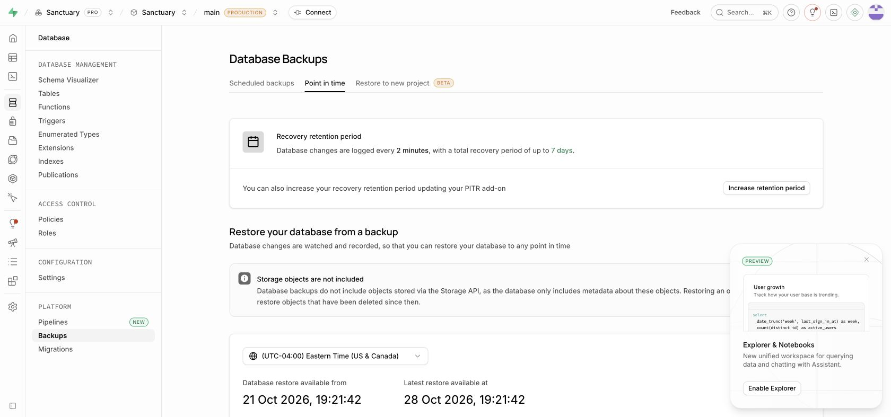

# Daily Discovery rollout record — October 28–29, 2026

Status at 2026-10-29 12:07 UTC: production infrastructure and private generation are installed. **Public trivia, website promotion, native public releases and reminder delivery remain held for content readiness and device acceptance.** No trivia push has been sent. This record replaces intermediate checkpoints; it does not claim a completed public launch.

## Production recovery and database

The owner explicitly approved seven-day PITR and the required Small compute upgrade. Both are enabled on production project `cmakuvkjxknwhonfqbit`. The dashboard confirms a seven-day recovery period. PITR adds $100/month; the dashboard estimated Small's incremental compute cost at approximately $5.15/month over Micro.

All six migrations through `20261028234500_discovery_source_options.sql` were applied using the normal linked migration ledger after the production preflight passed. Each migration and rollback has transaction-scoped 3-second lock and 60-second statement timeouts. All 13 new tables force RLS and deny direct anonymous/authenticated SELECT access. Hosted schema comparison found no unintended legacy policy/column/index changes. The reminder migration intentionally expands notification category constraints and preference auditing.

A schema-only proof branch, `gjwvtqdfqprzcpgqrfhr`, restored 39 editorial devotional rows and four disabled notification settings from a scoped sanitized production snapshot. Synthetic fixtures matched 46 profiles, 108 campaigns and 319 deliveries. No production accounts, tokens, subscriptions, preferences or completions were copied. Six-migration apply, reverse rollback and reapply preserved the legacy query-result hash `cd9826c60ff0b4ca16ff902dd5a7f59371f743eac680e1eaf0c509f4b63f8160`. This is a scoped production-shaped rehearsal, not a full physical restore.

Evidence: [hosted proof](qa/2026-10-29/hosted-migration-proof.json), [pre-migration recovery bookmark](qa/2026-10-29/pre-migration-recovery-bookmark.json), [latest runtime and dry-run checks](qa/2026-10-29/production-release-status.json). Refresh the recovery bookmark before any subsequent database rollout.

## Backend and generation

Production API: https://api.sanctuaryapp.us. Render service: `srv-d1uqipvdiees73b0kj20`. The final backend deployment `dep-dbhje3p42hec73ckhov0` and cron deployment `dep-dbhje45g1s2s73a82kug` are live at `64ed60bbaa30e351de9fdd6d5df361130d96e463`, including the 30-day status/runway default. Subsequent evidence-only commits do not change runtime behavior. Health returns 200. The public bundle returns 200 with `enabled:false` and zero items. Unauthenticated generation, capability registration and dispatch return 401.

The active Render cron is `crn-dbh7s9ek1f9s73aur280`, `sanctuary-daily-discovery-curriculum`, at **08:15 UTC daily**. It runs `npm run cron-discoveries` on Node 22, with generation enabled, auto-approval enabled, a 30-day target, seven considered dates per run, and 150,000-token budget checked between attempts. An in-flight request can exceed that boundary. Three persisted attempts per date prevent endless retry; exhaustion produces a failed job and requires explicit reviewed repair. Auto-deploy is off; explicitly deploy the reviewed branch after changes.

Production models remain writer `gpt-5.6-sol`, verifiers `gpt-5-mini` and `gpt-6-astra`. Every question premise, claim and option verdict must score at least 95; both blind reviewers must independently agree on the key, exact source evidence and scope. Craft must reach 6/8 with no zero dimension. Difficulty is assessed independently of the assigned target. These scores are not a calibrated 95% probability of truth.

The first production run `a8ddbf0c-abd7-4af8-a604-29dbc41102ab` accepted two candidates, rejected ten, exhausted three dates and correctly failed its job. The source-v3 planner subsequently precommitted three narrative source options per date; SQL binds each attempt to its source hash. Two bounded fill jobs, `job-dbh8kr0n74is73cl7iq0` and `job-dbh8kr67bikc73dt60ag`, completed unsuccessfully due to exhausted dates. No failed candidate was converted to an approval.

The explicit v2→v3 source-plan repair archived the old plans, preserved approved questions, reset four named dates under the owner's administrator workflow, and held the awkward future James mirror question before publication. Old attempts, reviews and immutable revisions remain. No human factual attestations were fabricated. Exhausted v3 dates have not been silently reset.

At the final checkpoint there are **nine scheduled questions total**, including October 28; **eight are today/future**, with only **two consecutive days through October 30**. October 31–November 4 and November 7 exhausted their budgets. The scheduled morning run `3393b7f1-b2f9-49e9-a5de-f8796a5659e3` approved four questions, rejected seven drafts and reported 152,667 tokens. It also exhausted November 7, so the cron correctly signals an unsuccessful job despite useful accepted content. November 12 has an expired lease with one consumed attempt and can resume. This is short of the 30-day initial library and sustainable 14-day runway required by the release runbook.

A separate no-database writing experiment used `gpt-6.1-sol` with `gpt-5.6-sol`/`gpt-6-astra` reviewers. It accepted four of seven planned scenes before its token bound; other drafts failed craft or contextual support. The audit is under `content/discoveries/experiments/writer-quality-comparison-2026-10-29*`. This small experiment is neither calibration nor a reason to change production models or lower thresholds. Its drafts are unpublished and not imported.

## Reminders

The existing Vercel `/api/push/dispatch` cron remains the only reminder scheduler, every 15 minutes. Discovery is disabled in `dry_run`, at 18:00 recipient-local time. Only explicit boolean `notifications.trivia === true` opts a user in. There is no existing-user opt-in backfill. Unsupported native versions are skipped unless web delivery is available. Completion, rollout visibility, quiet hours, six-hour spacing and daily deduplication are enforced.

The authenticated production dry run returned 200 with zero eligible, attempted, accepted or failed sends. The earlier 05:30 UTC check saw all 46 profiles outside the local send window; the latest detailed skip counts are saved in the evidence JSON. There are zero Discovery delivery records. This checks production wiring, not delivery acceptance on a real device. Keep the category off until content and device checks pass, then use an opted-in internal account before staged expansion.

## Websites

Both production-environment builds are staged using `--prod --skip-domain`:

- Main/canonical web project: https://sanctuary-layperson-webapp-8zbezsxul.vercel.app
- Separate marketing project: https://sanctuary-app-home-qtr8-brj1sloxz.vercel.app

`sanctuaryapp.us`, `www` and `beta` belong to the layperson project and remain on the prior deployment `dpl_GK3wmKbohymfivp41ES7K9pcTTEU`. The separate marketing project has no custom domain. Staged trivia returns 200, missing cron authentication returns 401, and marketing's Scripture endpoint returns an exact bounded WEB passage. No preview or loopback environment values were placed in production builds.

A browser connected to the hosted staging database completed an actual generated question, showing 3.1 seconds, one correct-day streak and the preferred WEB passage. [QA screenshot](../../sanctuary-layperson-web/docs/qa/2026-10-28/hosted-stage-result.jpg). This guest test did not create a production completion.

## Native store drafts

Version **1.2.11** is signed and uploaded:

- iOS build **63**: EAS `4ac1ed3f-4a3d-4ce9-aa3c-12361c5a1082`; successful upload `be600d49-0c7c-4a92-b650-ffcdbe912725`.
- Android code **134**: EAS `2b135c3e-8bce-485d-8fa6-9577b96442ba`; successful internal-track upload `b00d811c-087d-4e90-8483-8fc073e13add`.

The expired iOS certificate/profile were renewed through October 28, 2027 for the existing bundle/team. Push and App Store API keys were preserved. App Store metadata and six existing screenshots synced successfully after correcting a PNG filename mismatch. Existing age-rating answers were preserved. Build 63 was attached to the 1.2.11 draft and saved with manual release selected; the browser session later expired. No App Review submission was made.

Google Play production draft release 16 contains only bundle 134, with release notes saved. Preliminary checks passed. Its only bundle warning is the absent optional deobfuscation file. The publishing overview says the change can be sent for review. It has **not** been sent for review or released. Current Android production remains 133/1.2.10. See [native release record](../../sanctuary-mobile/docs/releases/1.2.11.md).

## Validation and remaining launch work

Backend application and complete Supabase migration/reset/lint CI both passed on the deployed final runtime commit, including the test-clock repair. Local verification includes the full backend suite, mobile typecheck, 14 Discovery tests and behavior checks, both web builds/typechecks, scoped lint, hosted rollback/reapply and live API smoke checks. Backend production dependencies have zero npm audit advisories. The final reminder fixture freezes both SQL and dispatcher clocks so it remains valid after October 28.

The remaining launch work is concrete: repair exhausted source plans through the explicit editorial workflow, build and inspect the 30-day approved schedule, verify physical-device accessibility/offline/sharing/app-link/cold-notification paths, then enable the internal cohort. Promote tested websites and submit native releases only after those gates; expand content and reminder cohorts through the documented stages. Do not lower evidence/craft thresholds to force a launch date.

Related draft PRs: [backend #17](https://github.com/brarduous/sanctuary-backend/pull/17), [mobile #3](https://github.com/brarduous/sanctuary-mobile/pull/3), [web #3](https://github.com/brarduous/sanctuary-layperson-web/pull/3), [marketing #2](https://github.com/brarduous/sanctuary-marketing-home/pull/2).
